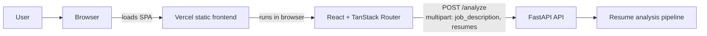

# Shortlist Resume Screener

Shortlist is a React, Vite, and TanStack Router single-page app in `frontend/`,
backed by a FastAPI service in `backend/`. Screening data is persisted in the
browser and uploaded resume PDFs are stored in IndexedDB. An opt-in local mock
scorer is available for demos.

## Architecture



The browser calls the API URL configured by `VITE_API_URL`. See
[docs/architecture.md](docs/architecture.md) for the frontend data flow,
[backend/README.md](backend/README.md) for backend setup, and
[backend/ml/REPORT.md](backend/ml/REPORT.md) for the current model report.

## Quick start

### Backend

From the repository root, create a Python virtual environment and run the API
from `backend/` (the setup commands below are for PowerShell):

```powershell
cd backend
python -m venv venv
.\venv\Scripts\Activate.ps1
python -m pip install -r requirements-ml.txt
python -m pip install -r requirements.txt
Copy-Item .env.example .env
uvicorn app.main:app --port 8000
```

Set `ALLOWED_ORIGINS` to the frontend origin(s) in `backend/.env`; its template
contains the existing Vercel domains and both local development origins.

### Frontend

From the repository root:

```powershell
npm --prefix frontend ci
Copy-Item frontend/.env.example frontend/.env.local
npm --prefix frontend run dev
```

Vite uses its default development URL, `http://localhost:5173/`. The frontend
template sets `VITE_API_URL=http://localhost:8000` and `VITE_USE_MOCK=false`.
Set `VITE_USE_MOCK=true` to run the optional browser-only demo scorer instead
of calling the API.

## Checks

Run the frontend checks from the repository root:

```powershell
npm --prefix frontend run lint
npm --prefix frontend test
npm --prefix frontend run build
```

Run backend tests from `backend/` with `python -m pytest`. The backend API
contract and additional setup details are documented in
[backend/README.md](backend/README.md).

## Deployment

The Vercel project builds the SPA from `frontend/` using the root
[`vercel.json`](vercel.json) configuration. Set `VITE_API_URL` in the Vercel
environment to the public HTTPS backend URL and redeploy. See
[docs/deployment.md](docs/deployment.md) and
[docs/local-testing-with-ngrok.md](docs/local-testing-with-ngrok.md) for
deployment and preview testing instructions. The root `vercel.json` is active
when Vercel's Root Directory is the repository; keep `frontend/vercel.json` as
the dashboard fallback when the Root Directory is `frontend`.
