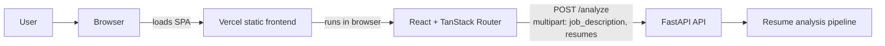

# Shortlist Resume Screener

Shortlist is a React, Vite, and TanStack Router single-page app backed by a
FastAPI resume-analysis service. Screening state is persisted in the browser;
PDFs are stored in IndexedDB. The app has an opt-in, client-side mock scorer for
demo use.

## Architecture



The browser calls the API URL configured by `VITE_API_URL`. See
[backend/README.md](backend/README.md) for API setup and
[backend/ml/REPORT.md](backend/ml/REPORT.md) for the current model report.

## Quick start

### Backend

Create and activate a Python virtual environment, then follow the dependency
setup in [backend/README.md](backend/README.md). A PowerShell local run from the
repository root is:

```powershell
cd backend
python -m venv venv
.\venv\Scripts\Activate.ps1
python -m pip install -r requirements-ml.txt
python -m pip install -r requirements.txt
Copy-Item .env.example .env
uvicorn app.main:app --port 8000
```

Set `ALLOWED_ORIGINS` to the frontend origin. The checked-in
[backend/.env.example](backend/.env.example) includes localhost ports 8080 and
5173.

### Frontend

From the repository root:

```sh
npm ci
Copy-Item .env.example .env.local # PowerShell; use cp on macOS/Linux
npm run dev
```

Vite's default development URL is `http://localhost:5173/`. The frontend
environment template sets `VITE_API_URL=http://localhost:8000` and
`VITE_USE_MOCK=false`. Set `VITE_USE_MOCK=true` to use the local demo scorer
instead of the API.

## Checks

```sh
npm run lint
npm test
npm run build
```

Run backend tests from `backend/` with `python -m pytest`.

## Deployment

The SPA is deployed to [Vercel](https://vercel.com/) with the repository's
`vercel.json` rewrite for client-side routes. Configure `VITE_API_URL` in the
Vercel project for a reachable API. Backend hosting is not configured in this
repository. See [docs/deployment.md](docs/deployment.md) for deployment and
preview guidance.
