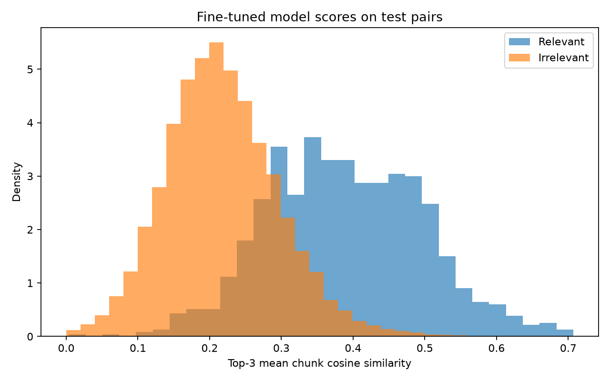

# Resume ranking evaluation

Metrics are macro-averaged over job-description queries. Candidates are resumes from the corresponding held-out split.

| Ranker | NDCG@10 | MAP | Precision@5 |
| --- | ---: | ---: | ---: |
| TF-IDF | 0.3780 | 0.3459 | 0.4083 |
| Pretrained MiniLM | 0.5547 | 0.4915 | 0.5958 |
| Fine-tuned MiniLM | 0.6034 | 0.5635 | 0.6375 |

## Handwritten job descriptions

Eight manually written descriptions across eight categories provide an out-of-template sanity check.

| Ranker | NDCG@10 | MAP | Precision@5 |
| --- | ---: | ---: | ---: |
| TF-IDF | 0.5022 | 0.4461 | 0.5000 |
| Pretrained MiniLM | 0.6448 | 0.5496 | 0.6500 |
| Fine-tuned MiniLM | 0.6517 | 0.6085 | 0.7500 |

## Fine-tuned score distribution

Raw semantic cosine scores for relevant and irrelevant test pairs:

## Limitations

- Job descriptions are synthetic proxies except for the separate eight-description sanity check.
- Relevance means the resume has the same dataset category; it does not represent real hiring outcomes.
- The dataset contains 24 coarse categories from a public Kaggle scrape.
- These results do not prove real-world hiring accuracy.
