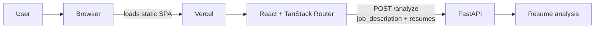

# Architecture

The repository has two deployable parts: a browser-only React/Vite SPA in
`frontend/` and a FastAPI API in `backend/`. The SPA is hosted on Vercel; backend
hosting has not been set up in this repository.

The frontend sends `multipart/form-data` to
`{VITE_API_URL}/analyze`, with `job_description` and one or more `resumes`
fields. The response is represented by `BackendAnalysisResult` in
`frontend/src/features/screening/api.ts`. The API schema and setup are
documented in [backend/README.md](../backend/README.md).

Screening state is stored in browser localStorage and resume PDFs in IndexedDB;
there is no frontend database service. `VITE_USE_MOCK=true` opts into the
browser-side demo scorer and PDF text extraction. The normal mode calls the
backend.

TanStack route modules are in `frontend/src/routes/`. The route tree in
`frontend/src/routeTree.gen.ts` is maintained by hand because this project does
not configure the TanStack Router Vite plugin.
